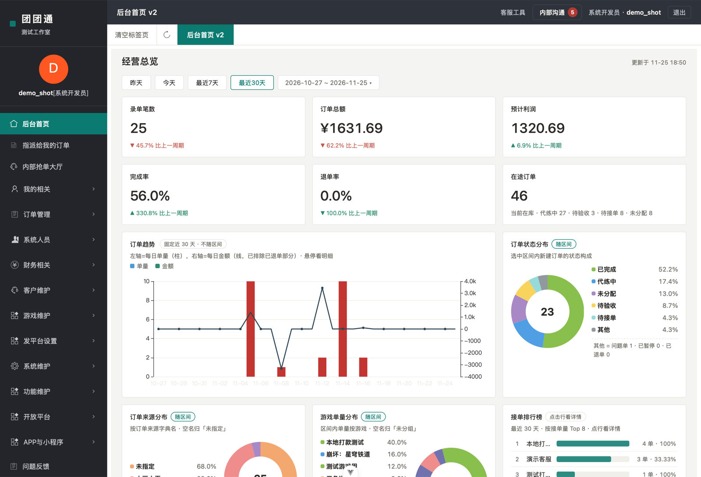
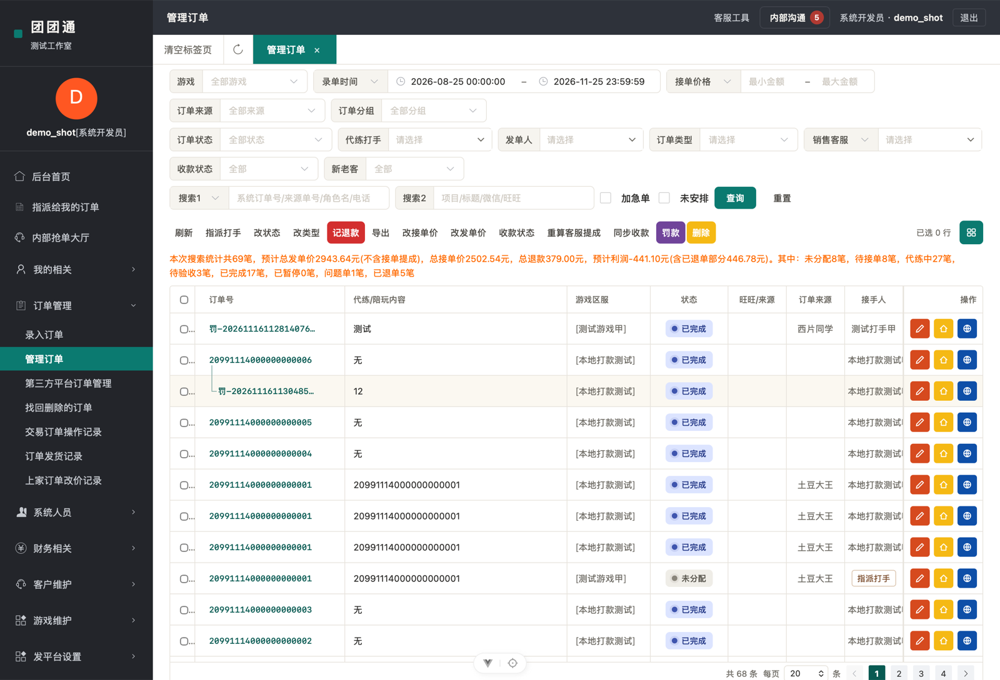
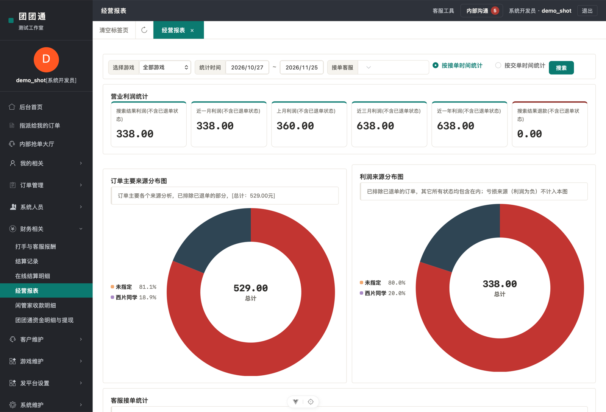
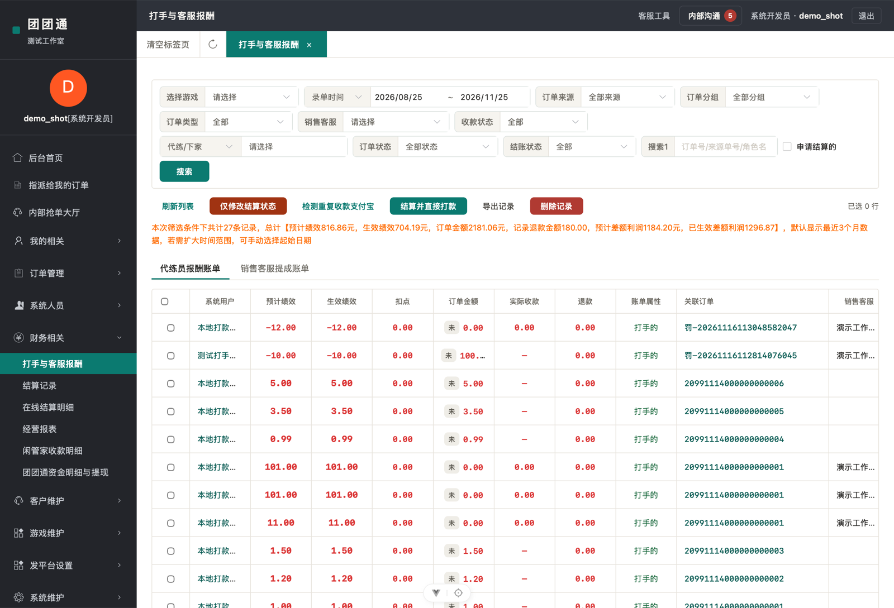

# Tuantuantong · Web Edition

> An **internal order management system** for game-boosting / play-companion studios — a multi-tenant web app in the spirit of **Jidanpu** (鸡蛋铺).

[中文](README.md) ｜ **English**

Every studio (tenant) gets its own domain and its **own PostgreSQL database**; tenants cannot connect to each other's data at the connection level.

## Screenshots


*Overview: order volume, revenue, profit, completion rate, trend and taker ranking*


*Order management: multi-condition filters, batch actions, one-click publish to third-party platforms*


*Business report: order-source distribution, profit sources, support-agent stats*


*Taker / support payroll: commission, deductions, settlement and export*

> Screenshots come from a local dev environment; all data is synthetic.

## Features

**Full order lifecycle**
- Order intake (recognition + bulk entry), order management, order detail
- Status transitions, price/type changes, refunds, urgent / on-hold, assignment
- Order grouping and merging, restore deleted orders, operation logs, shipping logs, upstream price-change logs

**Dispatch and grabbing**
- Internal grab hall, assignment to takers, "my orders"
- Grabbing is guarded by an application-level check plus a database unique constraint — no overselling

**Third-party platforms**
- Order sync, one-click publishing and callbacks for Jidanpu / Dailiantong and similar platforms
- Auto-reply, auto price adjustment, upstream status polling and reconciliation

**People and permissions**
- Role-based permission nodes, narrowed by game or line of business
- Staff management, real-name records, blacklist, login restrictions, e-contracts
- Per-game permissions, order caps, price ranges, deposit quotas

**Finance and settlement**
- Taker / support remuneration and commission, deductions, settlement records
- Online settlement with Alipay payout, taker wallet and withdrawal review
- Fund details, business reports, daily reports, support-agent statistics

**Customers and games**
- Customer records, customer analysis, customer blacklist, new-vs-returning detection
- Game and server management, order project categories and favourites

**Messaging and collaboration**
- In-app notifications, feedback, internal chat
- WeCom group-chat archiving and search, WxPusher push, QQ bot
- Support-agent toolkit

**Open platform**
- OpenAPI (order read/write endpoints, unified response envelope)
- App management, taker integration, performance analysis

## Deployment

Prerequisites: Python 3.13, [uv](https://docs.astral.sh/uv/), PostgreSQL 16, Node (`^22.18` or `>=24.12`), pnpm.

### One-command bootstrap

```sh
cp .env.example .env     # edit database credentials, DJANGO_SECRET_KEY and POSTGRES_ADMIN_USER first
bash scripts/quickstart.sh
```

The script installs backend dependencies, creates the platform database and tables, provisions the first tenant, then prints the two commands left to run (set the admin password, start the server).

The manual steps below are the same thing, if you prefer to follow along.

### 1. Configure

```sh
cp .env.example .env          # edit the placeholders: database, secret key, allowed hosts
```

Create an application role and an empty database owned by it:

```sh
psql -U postgres -c "CREATE ROLE tt LOGIN PASSWORD 'change-me' CREATEDB;"
psql -U postgres -c "CREATE DATABASE tuantuantong OWNER tt ENCODING 'UTF8';"
```

You also need `POSTGRES_ADMIN_USER` in `.env` — an operations account with permission to create databases and roles (used only when provisioning tenants).

### 2. Install, migrate, provision the first tenant

```sh
cd src
uv sync
uv run python manage.py migrate_schemas --shared      # platform (public) schema
uv run python manage.py provision_tenant_db \
  --schema demo --name "My Studio" --domain demo.test.local   # creates DB + role + tenant schema
uv run python manage.py set_tenant_password --schema demo     # set the admin password (interactive)
```

### 3. Run

```sh
uv run python manage.py runserver 127.0.0.1:8000
```

Frontend:

```sh
cd src/frontend
pnpm install
pnpm dev            # development; use pnpm build for production and serve dist with nginx
```

During development the frontend and backend are same-origin: requests hit Vite first, which proxies them to Django and **rewrites the `Host` header to the tenant domain** — that is how `django-tenants` resolves the tenant. `VITE_TENANT_HOST` in `src/frontend/.env.local` must match the domain you provisioned above.

In production run the backend with gunicorn, serve the frontend build with nginx and reverse-proxy `/api`. Connection pooling and other parameters are documented in `.env.example`.

## Project layout

```
.
├── .env.example          # backend env template (copy to .env at the repo root)
└── src/
    ├── manage.py
    ├── pyproject.toml    # backend dependencies (locked by uv.lock)
    ├── config/           # Django settings, root URLconf, WSGI
    ├── apps/             # business apps: accounts, orders, finance, provisioning, open platform…
    ├── jidanpu/          # vendored third-party (Jidanpu) SDK
    ├── sdk/              # small SDKs
    ├── tests/            # backend tests
    └── frontend/         # tenant admin SPA (Vue 3 + Vite)
```

## How tenant isolation works

- **One database and one role per tenant**: after creating the database we run `REVOKE ALL ON DATABASE … FROM PUBLIC`, so each role can connect only to its own database.
- **Tenant context comes only from the authenticated session and the host name** — never from request parameters. Every query must carry tenant context.
- Provisioning a tenant is an explicit operation: `manage.py provision_tenant_db --schema <name> --name <display> --domain <domain>`.
- ⚠️ The operations account (`POSTGRES_ADMIN_USER`) can reach every tenant database by design — never put it on a tenant machine.

## Contributing

- Found a bug or want a feature? Open an [Issue](../../issues).
- Have a change? Send a [Pull Request](../../pulls).
- Contributions are welcome. Opening an Issue first to align on the approach is recommended.

## Contact

If this is useful to you, add me on QQ — we can **connect our systems and help you take on more orders**.


QQ: **67071486**

## License

[MIT](LICENSE)
