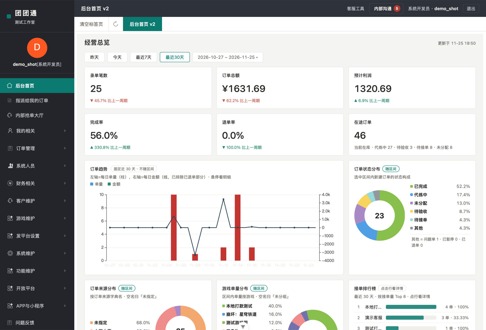
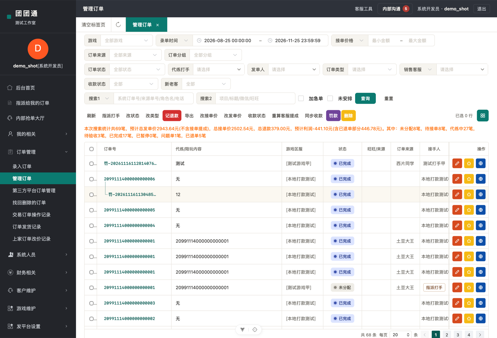
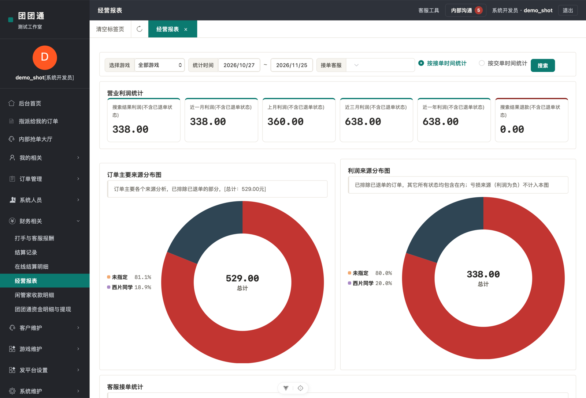
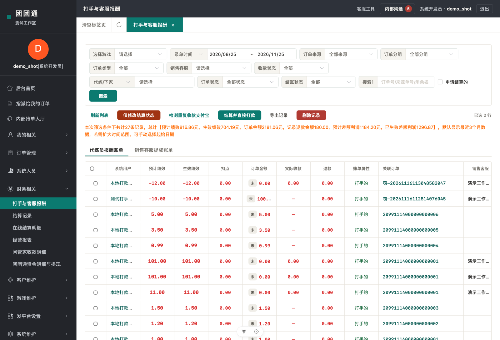

# 团团通 · 网页版

> 类似「**鸡蛋铺**」的**内部订单管理系统** —— 面向游戏代练 / 陪玩工作室的多租户订单一站式管理（网页版前后端源码）。

**中文** ｜ [English](README.en.md)

每个工作室独享自己的域名和**自己的 PostgreSQL 数据库**，租户之间在连接层就连不上。

## 界面截图


*经营总览：单量、金额、利润、完成率、订单趋势、接单排行*


*管理订单：多条件筛选、批量操作、一键发单到第三方平台*


*经营报表：来源分布、利润来源、客服接单统计*


*打手与客服报酬：提成、扣点、结算与导出*

> 截图来自本地开发环境，数据为合成数据。

## 功能

**订单全流程**
- 录单（含订单识别、批量录入）、管理订单、订单详情
- 状态流转、改价、改类型、退款、加急 / 搁置、派单
- 订单分组与合并、删除找回、操作记录、发货记录、上家改价记录

**派单与抢单**
- 内部抢单大厅、打手指派、我的订单
- 抢单走「应用层快速判断 + 数据库唯一约束兜底」，不会超卖

**第三方平台打通**
- 鸡蛋铺 / 代练通等平台订单同步、一键发单、回调接收
- 平台自动回复、自动调价、上家订单状态回拉与对账

**人员与权限**
- 角色 / 职位权限节点，可按游戏、业务线收窄
- 人员管理、实名记录、人员黑名单、登录限制、电子合同
- 游戏权限、接单上限、抢单价范围、押金额度

**财务与结算**
- 打手 / 客服报酬与提成、扣点、结算记录
- 在线结算与支付宝代付、打手钱包与提现审核
- 资金明细与提现、经营报表、日报、客服接发单统计

**客户与游戏**
- 客户档案、客户分析报表、客户黑名单、新老客识别
- 游戏与区服管理、订单项目分类与常用项目

**消息与协作**
- 站内通知、问题反馈、内部沟通
- 企业微信群聊归档与检索、WxPusher 推送、QQ 机器人
- 客服工具面板

**开放平台**
- OpenAPI（订单读写接口，统一响应体）
- 应用管理、打手对接、性能分析

## 部署

前置：Python 3.13、[uv](https://docs.astral.sh/uv/)、PostgreSQL 16、Node（`^22.18` 或 `>=24.12`）、pnpm。

### 1. 配置

```sh
cp .env.example .env          # 打开改掉里面的假值（数据库、密钥、允许域名）
```

数据库准备一个**应用账号**和一个空库（属主是它）：

```sh
psql -U postgres -c "CREATE ROLE tt LOGIN PASSWORD '你的密码' CREATEDB;"
psql -U postgres -c "CREATE DATABASE tuantuantong OWNER tt ENCODING 'UTF8';"
```

`.env` 里还需填 `POSTGRES_ADMIN_USER`（有建库建角色权限的运维账号，仅供供给租户时使用）。

### 2. 装依赖 + 建表 + 开通第一个租户

```sh
cd src
uv sync
uv run python manage.py migrate_schemas --shared      # 平台面（public）建表
uv run python manage.py provision_tenant_db \
  --schema demo --name "我的工作室" --domain demo.test.local   # 建库建角色 + 租户库内建表
uv run python manage.py set_tenant_password --schema demo     # 设 admin 密码（交互式）
```

### 3. 起服务

```sh
uv run python manage.py runserver 127.0.0.1:8000
```

前端：

```sh
cd src/frontend
pnpm install
pnpm dev            # 开发；生产用 pnpm build，产物交给 nginx
```

开发期前端与后端同源：请求先到 Vite，再由它代理给 Django，并**在转发时把租户域名写进 `Host` 头**——`django-tenants` 靠这个头解析租户。前端 `.env.local` 的 `VITE_TENANT_HOST` 要和上面开通的域名一致。

生产环境用 gunicorn 跑后端、nginx 托管前端构建产物并反代 `/api`，数据库连接数、长连接等参数见 `.env.example` 里的说明。

## 目录结构

```
.
├── .env.example          # 后端环境变量模板（复制成仓库根的 .env）
└── src/
    ├── manage.py
    ├── pyproject.toml    # 后端依赖（uv.lock 锁定版本）
    ├── config/           # Django 设置、根路由、WSGI
    ├── apps/             # 业务应用：账号、订单、财务、平台供给、开放平台……
    ├── jidanpu/          # vendor 进来的第三方（鸡蛋铺）SDK
    ├── sdk/              # 小型 SDK
    ├── tests/            # 后端测试
    └── frontend/         # 租户后台 SPA（Vue 3 + Vite）
```

## 多租户是怎么隔离的

- **一租户一库一角色**：建库后 `REVOKE ALL ON DATABASE … FROM PUBLIC`，角色只对自己那个库有 `CONNECT`，租户之间在连接层就连不上。
- **租户上下文只来自认证态与域名**，绝不接受请求参数传入；任何新增查询都必须携带租户上下文。
- 开通新租户是一次显式操作：`manage.py provision_tenant_db --schema <名> --name <名称> --domain <域名>`。
- ⚠️ 运维身份（`POSTGRES_ADMIN_USER`）按设计能连每一个租户库，**不要**把它配到租户机上。

## 参与开发

- 发现问题、想要新功能 → 提 [Issue](../../issues)
- 有改动想合进来 → 提 [Pull Request](../../pulls)
- 欢迎一起完善，提 PR 前建议先开 Issue 对一下思路，避免白做

## 联系作者

如果觉得好用，欢迎加我 QQ 交流 —— 可以**互相对接系统、帮你消化订单**。


QQ：**67071486**

## 许可证

[MIT](LICENSE)
